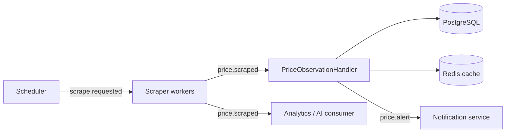

# CheapSheep 🐑

A price alert API. Register an Amazon or MercadoLibre product URL, set the discount you care about, and CheapSheep tracks the price over time, alerts you when it drops past your threshold, and explains the trend in plain language.

Built as a portfolio project and as a deliberate way to practice event-driven backend architecture with Java and Spring Boot.

---

## Features

- **Track products**: register a product URL with a discount threshold that triggers an alert.
- **Price history**: every scrape is stored, so you can see how a price moved over time.
- **Alerts**: when the price falls past your threshold, a notification event is emitted.
- **AI trend summaries**: an endpoint that uses the Anthropic API to summarise a product's price trend.
- **Pause / resume / delete**: pause scraping with `active`, or soft-delete a product entirely.
- **JWT auth**: access + refresh tokens, with logout invalidating the refresh token.

---

## Architecture

A scheduled scraper feeds a Kafka pipeline. Consumers persist prices, evaluate alert conditions, and notify users.



### Kafka topics

| Topic | Purpose |
|-------|---------|
| `scrape.requested` | Work queue that decouples the cron scheduler from the scraper worker pool |
| `price.scraped` | Fan-out stream of price observations, read by independent consumer groups |
| `price.alert` | Alert events consumed by the notification service |

**Why Kafka?** Multiple independent consumer groups can read the same stream, and historical events can be replayed into new consumers without re-scraping. Simpler queues don't offer that combination.

### Code structure

The codebase follows a hexagonal (ports and adapters) architecture: business logic sits at the centre and depends on nothing; Spring, Kafka, JPA and HTTP clients live in adapters at the edge. Patterns are only introduced where they earn their cost.

---

## Tech stack

| Area | Technology                                                    |
|------|---------------------------------------------------------------|
| Language / framework | Java 21, Spring Boot 4.x, Maven                               |
| Persistence | PostgreSQL                                                    |
| Messaging | Apache Kafka                                                  |
| AI | Anthropic API                                                 |
| Infrastructure | Docker Compose                                                |
| Ops / quality | Spring Boot Actuator, Lombok, Bean Validation, Testcontainers |

---

## API

All protected endpoints require `Authorization: Bearer <access_token>`.

### Auth

| Method | Endpoint | Description |
|--------|----------|-------------|
| `POST` | `/auth/register` | Creates the user and their profile |
| `POST` | `/auth/login` | Returns access + refresh tokens |
| `POST` | `/auth/refresh` | Returns a new access token from the refresh token |
| `POST` | `/auth/logout` | Invalidates the refresh token |

### Profile

| Method | Endpoint | Description |
|--------|----------|-------------|
| `GET` | `/user` | Returns the authenticated user's profile |
| `PATCH` | `/user/info` | Updates profile fields |
| `PATCH` | `/user/password` | Updates the password |

### Products

| Method | Endpoint | Description |
|--------|----------|-------------|
| `POST` | `/products` | Registers a product URL + alert threshold |
| `GET` | `/products` | Lists the user's active products with current price |
| `GET` | `/products/{id}` | Product detail + full price history |
| `PATCH` | `/products/{id}` | Updates alert threshold and/or `active` status |
| `DELETE` | `/products/{id}` | Soft delete: stops tracking |

### AI

| Method | Endpoint                 | Description |
|--------|--------------------------|-------------|
| `GET` | `/products/{id}/insight` | AI-generated price trend summary |

---

## Getting started

> Placeholder: commands will be finalised once the first runnable version lands.

### Prerequisites

- Java 21
- Maven 3.9+
- Docker and Docker Compose
- An Anthropic API key (only needed for the summary endpoint)

### Run locally

```bash
# 1. Start PostgreSQL, Redis and Kafka
docker compose up -d

# 2. Configure secrets
export ANTHROPIC_API_KEY=your-key-here

# 3. Run the application
./mvnw spring-boot:run
```

### Run the tests

```bash
./mvnw verify
```

Integration tests use Testcontainers, so Docker must be running.

---

## Project layout

```
.
├── docs/
│   ├── db-design.md
│   ├── api.yaml
│   └── PROJECT_OVERVIEW.md
├── src/
├── docker-compose.yml
└── pom.xml
```

---

## License

TBD